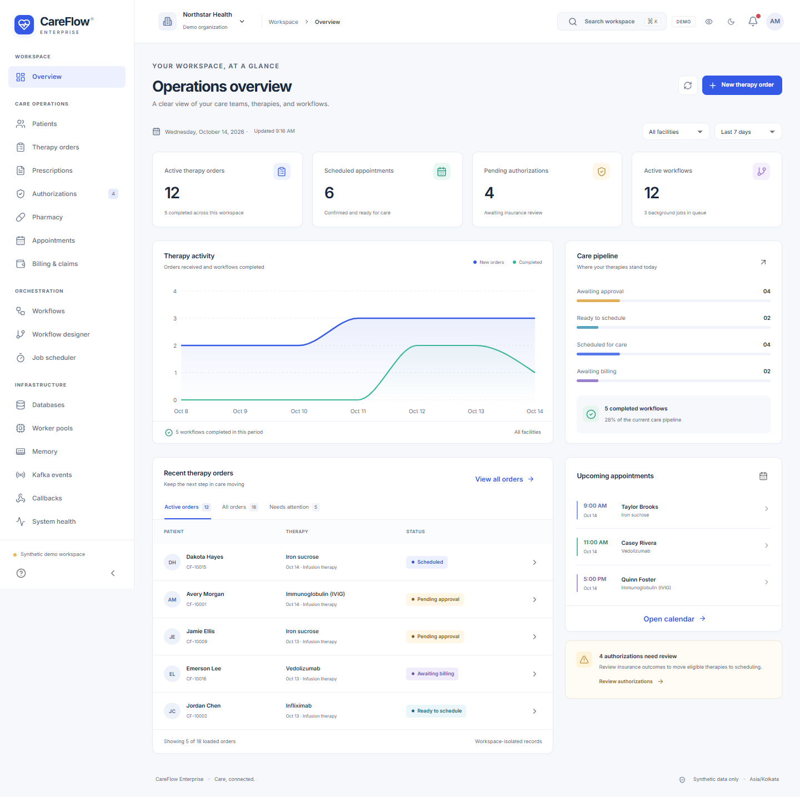
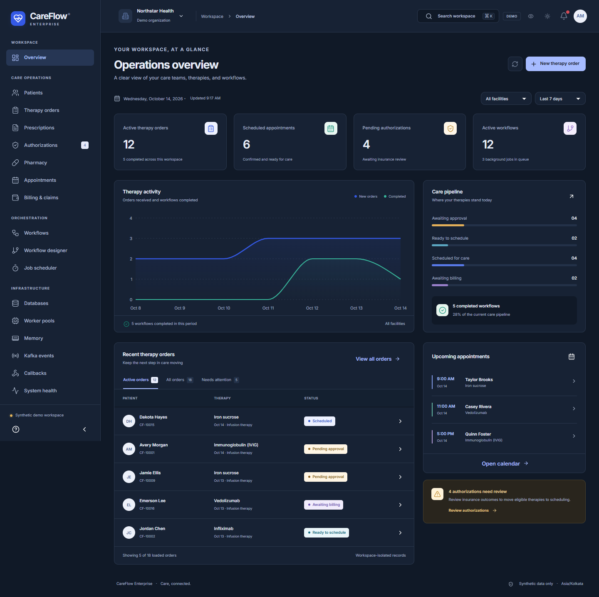
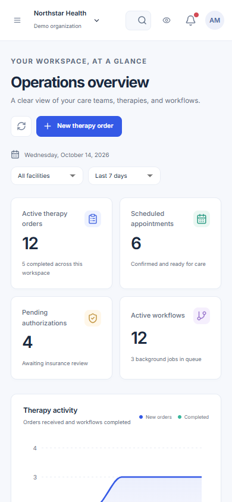

# CareFlow Enterprise portal

React 19 / TypeScript UI for the Go multi-tenant healthcare platform, implemented from `../Requirment UI.txt`. Uses Vite, Material UI, TanStack Query, Zustand, React Hook Form/Zod, Recharts, React Flow and FullCalendar.

## Screenshots

These screenshots show synthetic demo records.

### Operations dashboard



### Dark theme



### Mobile dashboard



## Therapy workflow



See the [detailed workflow guide](../docs/workflow.md) for tenant isolation, cancellation paths, background job retries, event delivery and API mappings. The [editable Mermaid source](../docs/diagrams/therapy-workflow.mmd) follows the implemented v1 state machine; designer drafts do not change active therapies.

## Start locally

Requires Node.js 22.12+ and npm. From the repository root:

```powershell
Set-Location careflow-react-portal
npm ci
npm run dev
```

Open http://127.0.0.1:5173. The initial workspace uses clearly labelled synthetic demo records. Demo mutations last for the browser session; reloading resets them. Switch between Northstar Health and Southridge Care to explore tenant isolation. The user menu offers previews of the five backend roles.

To connect real API records, start `scripts/dev.ps1` from the repository root in another terminal. It runs the API at port 18080. Generate a local development token in a separate root terminal:

```powershell
go run ./cmd/token -subject north-admin -tenant north-health
```

Open `/login`, enter `north-health` and the generated token, then select **Connect workspace**. The live tenant starts with no clinical records: create a facility, qualified staff and chair under Configuration before registering patients and booking therapies. Memory-store records disappear when the API restarts; use the root PostgreSQL setup for persistence. Never put signing keys in frontend environment variables.

Vite proxies `/api` to `http://127.0.0.1:18080`. Set `API_PROXY_TARGET` in `.env.local` for a different development API. The browser always uses same-origin requests.

## Implemented modules

| Area | Behavior |
| --- | --- |
| Workspace | Collapsible navigation, responsive layouts, theme switch, privacy masking, facility filter, tenant switching and role-aware routes/actions. |
| Dashboard | Authorized aggregate counts, daily activity and workflow status charts, recent orders and appointments. |
| Patient care | Search, registration, demographic editing within the existing facility, profiles, therapy/prescription references, care history and audit timeline. |
| Therapy workflow | Create orders; explicitly record insurance, medication readiness, clinical clearance, administration and billing outcomes; inspect checkpoints and cancel eligible workflows. |
| Appointments | Month/week/day calendar, nurse and resource selectors, facility capacity, booking, details and confirmed cancellation. Rescheduling releases the existing reservation before opening a new booking and is not atomic. |
| Scheduler | Reconciliation cron/interval creation, pause/resume/manual trigger, job history and confirmed retry/cancel actions. |
| Workflow designer | Connect and configure draft DAG steps, validate dependencies/cycles, save tenant-specific drafts on this device. Publishing arbitrary definitions requires a backend registry and approval service. |
| Operations | Primary storage readiness, explicitly shared Go runtime/worker metrics, bounded browser memory history, tenant outbox delivery and audit records. |
| Administration | Facilities/staff/resources, membership upserts with facility scopes, versioned quota reductions and local preferences. Alerts derive from loaded records; acknowledgments last for the page session. |

Pages use actual backend capabilities. Pharmacy shows medication readiness, not stock quantities; billing shows workflow submission state, not actual payer claims or payments. External database pools, Kafka broker lag/partitions, callback delivery registries, feature flags, automatic scaling, workflow publishing, holiday policies and notification delivery remain dependent on backend integrations. Unconfigured systems are identified in the UI.

## Authentication and tenant boundaries

The backend roles are `tenant_admin`, `clinical`, `billing`, `auditor` and `integration`. UI visibility follows those roles; the API remains the authorization authority. Platform administration does not imply clinical access. Clinical reads are audited and filtered by authorized facilities.

Bearer tokens and fetched clinical records stay in memory. Session or tenant changes abort requests and clear the query cache. Tenant selection is sent in `X-Tenant-ID`; tenant-bound tokens cannot change organizations. Privacy masking is a screen-sharing preference, not an access-control mechanism. Theme and workflow draft metadata may be saved locally; clinical records are not exported by clinical tables.

For OIDC Authorization Code + PKCE, copy `.env.example` to `.env.local` and supply `VITE_OIDC_AUTHORITY`, `VITE_OIDC_CLIENT_ID` and appropriate scopes. Register `${portalOrigin}/auth/callback` with your identity provider. Configure matching backend issuer/audience, pinned RS256 public key and active memberships. Temporary PKCE state uses session storage; access tokens use memory and are lost on reload. There is no automatic renewal: expired sessions return to sign-in. An external identity provider has not been exercised locally.

SSE uses an authorized fetch stream, with credentials in headers, tenant matching, bounded parsing and reconnect backoff. Refresh hints contain no clinical payload. Collection polling remains available if streaming fails. The server rechecks token validity and membership every 15 seconds.

## API mapping

The portal uses the existing Go resource contracts (`/orders`, `/workflows`, `/appointments`, `/schedules`, `/jobs`, `/events`, `/audit`, `/memberships/{user}`), rather than introducing parallel clinical endpoints. Added portal endpoints are documented in `../api/openapi.yaml`:

- `GET /api/v1/portal/overview?days=7&facility=all`
- `GET /api/v1/operations` (tenant administrator/auditor)
- `GET /api/v1/stream`
- `PATCH /api/v1/patients/{id}` (idempotent)
- `POST /api/v1/appointments/{id}/cancel` (idempotent)
- `PATCH /api/v1/configuration` (version compare-and-swap; quota increases remain platform controlled)

Collections load 100 records at a time using opaque cursors and a **Load more** control. Table search, filters, exports and list summaries apply to loaded records; the dashboard aggregation queries the full authorized dataset. Shared process measurements are not tenant utilization measurements.

## Verification

```powershell
npm test
npm run build
npx playwright install chromium
npm run test:e2e
```

Playwright starts Vite if required. For an installed local Chrome, set `$env:PLAYWRIGHT_CHROME='1'` instead of installing Chromium. The live test skips without a local synthetic-tenant credential. To run it against a running development API, from the repository root:

```powershell
$env:CAREFLOW_TEST_TOKEN = (go run ./cmd/token -subject north-admin -tenant north-health).Trim()
Set-Location careflow-react-portal
npx playwright test live.spec.ts
Remove-Item Env:CAREFLOW_TEST_TOKEN
```

Use only synthetic data for this test: it creates records. Its tracing and screenshots are disabled to keep credentials out of artifacts. Demo browser tests cover module rendering, tenant isolation, workflow completion, role denial, masking, themes, mobile overflow, designer drafts and automated dashboard accessibility. Automated axe checks do not establish complete WCAG conformance. CI builds, runs unit tests, starts an ephemeral Go API with a random signing key, and runs both demo and live browser journeys.

The nested `go.mod` is an intentional module boundary that keeps npm dependency Go sources out of root `go test ./...` discovery.

## Containers and Kubernetes

From the repository root, after configuring the ignored root `.env`:

```powershell
docker compose --profile ui up --build -d
```

Open http://127.0.0.1:15173. Nginx serves the SPA and proxies API/SSE requests to the Compose API. Container builds use locked dependencies and run TypeScript checks. `API_UPSTREAM` selects the internal Go host/port; it defaults to `api:8080` and must be a trusted operator setting. OIDC Vite values are build arguments. The default CSP permits same-origin connections: add the specific identity-provider origin to `connect-src` in `nginx.conf` when enabling external OIDC.

Build and publish `careflow-portal:local` (replace the image with your registry reference), then use `../deployments/kubernetes/portal.yaml` after deploying `api.yaml`. The example uses the `healthcare-api:80` Service, non-root Nginx, a read-only root filesystem and writable temporary/config volumes. Route a TLS ingress to `careflow-portal` so the browser and API share an origin. Kubernetes deployment, external OIDC and cloud infrastructure require your environment and are not provisioned by the UI.
