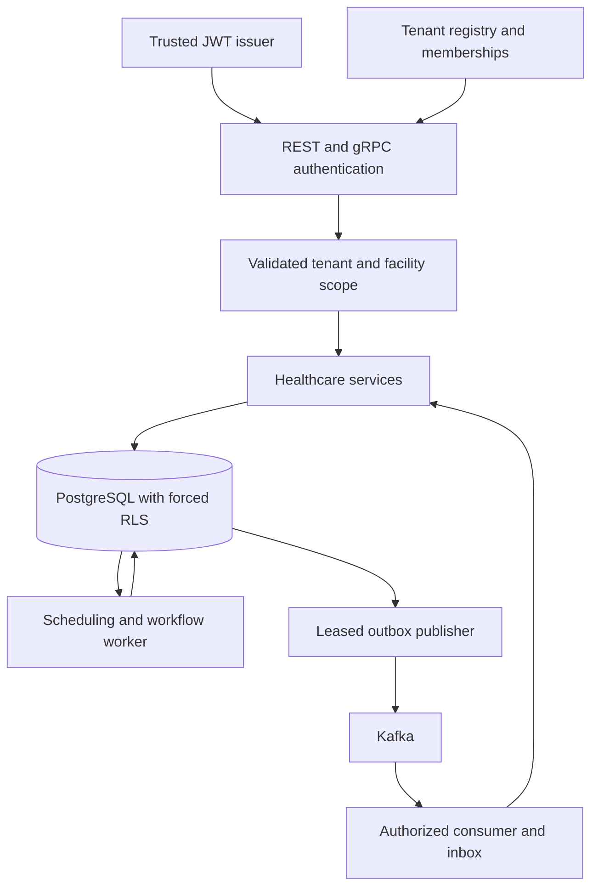

# Architecture and extension boundaries

The API, workflow worker and integration worker share domain types and a tenant-aware transactional repository. Registry/memberships form the control plane; clinical records, jobs, schedules, outbox and audit form the tenant data plane.

## Storage and consistency

PostgreSQL stores typed JSON documents with relational columns/generated identifiers that enforce tenant-scoped patient/facility relationships and identity uniqueness. Specialized repositories/indexes can replace these document operations for workloads that require them. Independent databases are not treated as one atomic transaction.

Mutations acquire the tenant registry row using `FOR UPDATE`, serializing writes for that tenant across processes. Reads use read-only transactions. Transaction-local `app.tenant_id` expires at commit/rollback, preventing connection-pool scope leaks. Startup requires a non-owner application login without superuser or BYPASSRLS privileges and forced RLS on resources.

Tenant serialization makes reservations, quotas, idempotency, event sequencing and suspension fencing straightforward but limits a single tenant's write throughput. High-volume deployment needs resource-specific locks/constraints, indexed due-job selection, archive/retention policies and measured admission budgets. Current historical scans use bounded pages but still scale with record count. Memory mode copies tenant state for rollback and is intended for small development datasets.

SQL Server billing, MongoDB metadata and Redis cache repositories are optional components with context-derived tenant filters, bounded pools and timeouts. They do not automatically synchronize with PostgreSQL. Add outbox-driven idempotent calls, persisted compensation and reconciliation for cross-database effects. Connection bindings and secrets must come from a trusted operator registry, never HTTP input. Resource authorization must precede metadata/cache access.

## Workflow and job guarantees

Built-in version 1 flow: `awaiting_approvals -> ready_to_schedule -> scheduled -> awaiting_billing -> completed`. Rejected prerequisites lead to `rejected`; eligible cancellation releases confirmed reservations and records compensation. Recorded approval does not independently determine prescription safety or clinical eligibility.

Jobs persist attempts, configuration versions, lease tokens and deadlines. Completion rechecks token and tenant status while holding the same transaction lock as domain effects. Short database handlers use deadlines shorter than their lease. Long-running/external handlers need heartbeats, durable checkpoints, downstream idempotency and fencing; do not simply add unbounded network calls inside the existing transaction.

Suspension blocks new requests/transactions. Already-running database transactions may commit before the suspension acquires the tenant lock. Already-admitted Kafka sends may finish, but acknowledgment then fails and redelivery can occur after reactivation. Offboarding/archive block ordinary access; automated retention holds, export and deletion are not implemented.

Cron/interval scheduling coalesces missed executions into one job. Reconciliation advances internal persisted workflow state and requires additional adapters to reconcile external systems. Memory reservations estimate admission costs rather than impose a hard heap cap.

## Messaging guarantees

State, idempotency, audit, outbox and event-sequence updates commit together. Publication chooses the earliest unpublished tenant sequence, and Kafka keys combine tenant and aggregate. A crash/lost acknowledgment can still duplicate or delay messages; downstream consumers must deduplicate by tenant/event ID and tolerate repeated sequences.

Inbound outcome application and inbox result share a transaction. Reusing an event ID with a different workflow/step/outcome is rejected. Serial consumption prevents offset commits from skipping earlier unfinished records. Scaling consumption requires independent partition workers that preserve partition ordering.

## Remaining requirement work

| Area | Extension or environment validation |
| --- | --- |
| Isolation tiers | Trusted resource-binding registry, schema/database routing, pool eviction, tenant migrations/cutovers and dedicated infrastructure. |
| Lifecycle | Resumable external provisioning, credential automation, exports/deletion, legal holds, tenant-only restore and recovery drills. |
| Configuration | Central provider, secret bindings, feature flags, permitted facility overrides, controlled rollouts and active-workflow migrations. |
| Workflow plugins | General versioned DAGs, parallel steps, callback contracts, timeout/escalation policies and durable cross-system Saga compensation. |
| Scheduling | One-time/delayed/dependency/priority APIs, holidays, home-care travel, rescheduling and reminders. |
| Resources | Metric-driven adaptive concurrency, service objectives, connection-budget feedback and large-volume profiling. |
| Interoperability | Approved payer/pharmacy/EHR contracts, prescription checks, real claims/reconciliation, full FHIR, HL7 v2, secure files and CDC. |
| Security | OIDC discovery/JWKS rotation, mTLS, consent policies, exceptional support access, object storage, comprehensive read auditing, retention and key management. |
| Operations | OpenTelemetry/Grafana, complete latency/lag metrics, tenant reports, profiling, alerts, load/soak/chaos/security and disaster-recovery validation. |

No external healthcare accounts are configured. Provider-specific submissions require organization contracts, service identities, schemas and approved rules.
