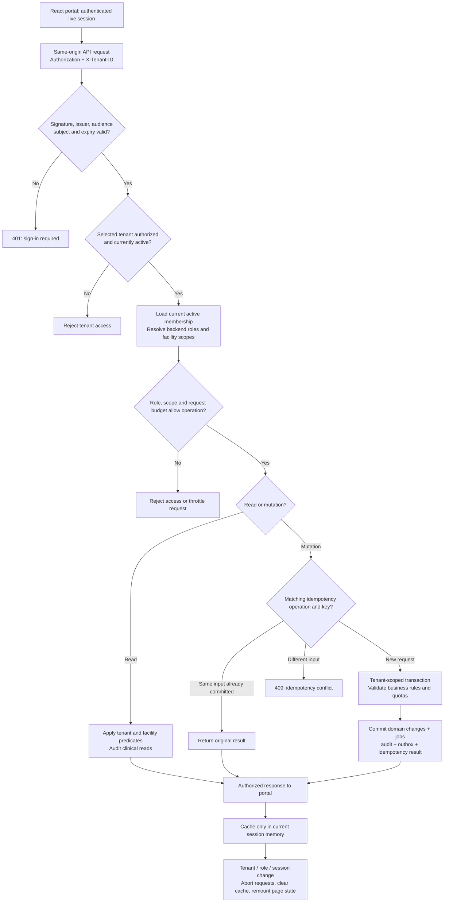
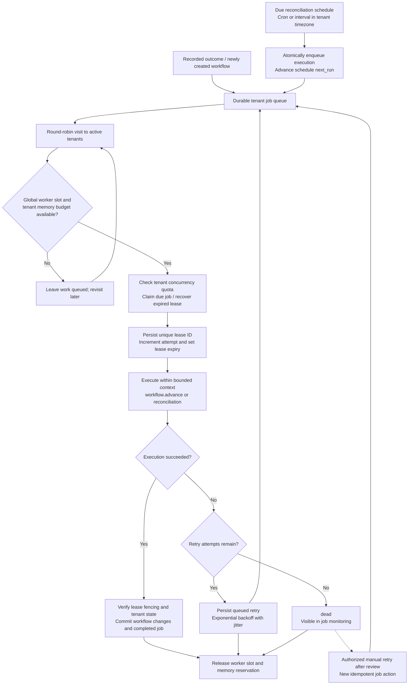
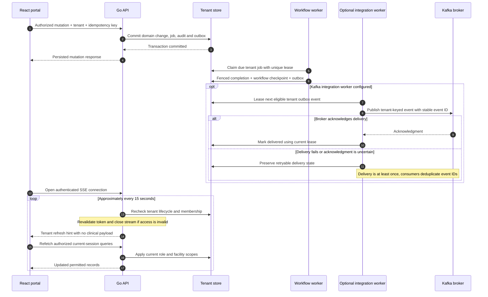

# CareFlow workflow

The diagrams describe the implemented Go workflow and the portal actions that drive it. External outcomes are explicitly recorded by authorized people or trusted integrations; HTTP transport success does not imply clinical clearance, insurance approval or medication availability. The browser demo simulates transitions in memory; live mode commits through the API and its background worker.

## End-to-end therapy lifecycle


The editable diagram source is [therapy-workflow.mmd](diagrams/therapy-workflow.mmd). Positive outcomes may arrive in any order while approvals are pending; the three branches represent independent prerequisites, rather than automatically invoked payer or pharmacy services.

To regenerate the README graphic with Mermaid CLI:

```powershell
npx --yes --package @mermaid-js/mermaid-cli@12.0.0 mmdc -i docs/diagrams/therapy-workflow.mmd -o docs/images/therapy-workflow.svg -c docs/diagrams/mermaid-config.json -b white
```

Run this from the repository root. Mermaid CLI requires a compatible browser; when using an existing Chrome installation, supply its Puppeteer configuration with `-p <config.json>`.

| Current state | Authorized action / condition | Result |
| --- | --- | --- |
| New order | Patient belongs to an authorized facility; required order input passes validation | `awaiting_approvals`; order, workflow, initial job, audit and outbox changes commit together. |
| `awaiting_approvals` | Record `insurance=approved`, `inventory=available`, `clearance=approved` | Worker advances to `ready_to_schedule` once all three are recorded. |
| `awaiting_approvals` | Record insurance/clearance rejection or inventory unavailability | Worker advances to `rejected`. Missing outcomes keep the workflow pending. |
| `ready_to_schedule` | Book an eligible appointment with no conflicts and available capacity | Atomically reserve resources and enter `scheduled`. |
| `scheduled` | Cancel the confirmed appointment before administration | Release its reservation and return the workflow to `ready_to_schedule`. A new booking is a separate operation. |
| Eligible pre-administration state | Cancel the workflow | Release confirmed reservations and enter `cancelled`. Cancellation is denied after administration, in `awaiting_billing`, or after completion. |
| `scheduled` | Record `administration=completed` | Worker enters `awaiting_billing` and marks confirmed appointments completed. |
| `awaiting_billing` | Record `billing=submitted` | Worker enters `completed`. This records submission state; it does not send or settle a real payer claim. |

Invalid roles, facility scope, state transitions, duplicate external identities, stale versions and conflicting idempotency requests are rejected by the backend. Booking checks patient, nurse and resource overlaps, facility capacity, an active infusion-qualified nurse, matching facilities, and a future duration of at most 24 hours.

## Tenant authorization and transaction flow



PostgreSQL adds forced row-level security and transaction-local tenant settings to application predicates. Memory storage is a development alternative. Current memberships and tenant lifecycle remain authoritative even if a token was issued earlier. Patient access is facility-scoped; the implementation does not provide a separate patient-specific ACL. Platform operator privileges do not imply clinical access.

Most domain mutations require `Idempotency-Key`. Tenant configuration instead uses version compare-and-swap; tenant administrators can reduce assigned quotas, while increases remain platform-control operations. An authorized session change clears client data; privacy masking is a display preference rather than authorization.

## Scheduler and background execution



Claims and completion use transaction checks and lease fencing to prevent a stale worker from completing a newer attempt. Scheduling and job creation commit together; missed intervals coalesce. Pause/resume controls future schedule dispatch, while cancellation and retry apply to eligible job states. The portal shows persisted job history; adaptive scaling and arbitrary workflow publishing are not implemented.

## Outbox delivery and portal refresh



SSE emits periodic refresh hints rather than pushing Kafka events or clinical records into the browser. Collection polling remains available when streaming reconnects. Without an integration worker, outbox events remain undelivered. Inbound Kafka outcomes use a registered, scoped integration identity and tenant/event inbox deduplication; offsets commit after a successful application transaction or acknowledged dead-letter delivery.

## Portal actions and backend contracts

| Portal action | API / processing path |
| --- | --- |
| Connect workspace | `GET /api/v1/me` validates membership and returns role/facility scope. |
| Register or edit patient | `POST /api/v1/patients`; `PATCH /api/v1/patients/{id}`. Editing does not transfer facilities. |
| Create therapy | `POST /api/v1/orders` creates the version-pinned workflow. |
| Record prerequisite, administration or billing result | `POST /api/v1/workflows/{id}/outcomes`; worker evaluates the next transition. |
| Confirm appointment | `POST /api/v1/appointments` validates and reserves resources atomically. |
| Release appointment | `POST /api/v1/appointments/{id}/cancel`; a new reservation requires a separate booking. |
| Cancel therapy | `POST /api/v1/workflows/{id}/cancel` checks eligibility and compensates reservations. |
| Configure or dispatch schedules | `POST /api/v1/schedules`; `POST /api/v1/schedules/{id}/actions`. |
| Retry or cancel jobs | `POST /api/v1/jobs/{id}/actions`. |
| Monitor changes | `/api/v1/portal/overview`, `/operations`, `/audit`, `/events` and `/stream`, with their respective role restrictions. |

The visual designer saves tenant-specific drafts locally. Draft graphs do not replace the running v1 state machine. Real payer claims, inventory synchronization, external callback registries and provider-specific clinical integrations require additional backend services.
